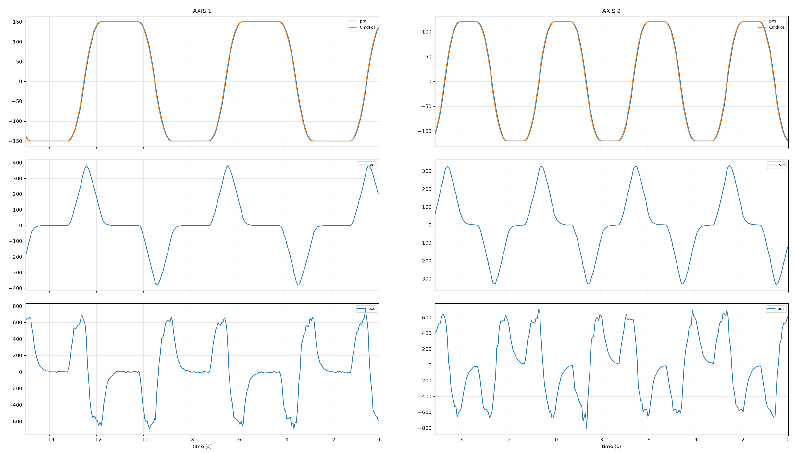

# PID-DEMO

A dual-axis stepper motor control system based on an STM32F411 microcontroller. The project implements closed-loop position and velocity control using magnetic rotary encoders, PID controllers and configurable motion profiles.

## Mechanical Assembly

The project incorporates three cycloidal reducer designs:

- **Left:** Cycloidal reducers driven by stepper motors, designed by [SweepDynamics](https://github.com/SweepDynamics) and [Promakina](https://github.com/Promakina), respectively.
- **Right:** Cycloidal reducer driven by a BLDC motor, designed by [sirojudinMunir](https://github.com/sirojudinMunir) ([SF-Motion](https://github.com/sirojudinMunir/sf-motion)).


## Features

- **Dual-axis control** – independent control of two stepper motor axes.
- **Closed-loop feedback** – AS5600 magnetic rotary encoders provide position feedback.
- **PID control** – separate position and velocity PID controllers for each axis.
- **Motion profiling** – trapezoidal and triangular position profiles, as well as velocity ramps.
- **Multiple operating modes** – position control, position oscillation, velocity control and velocity oscillation.
- **Configurable parameters** – setpoints, PID gains, oscillation amplitude, period, motor microstepping and step signal duty cycle.
- **OLED interface** – two displays and a rotary encoder with push-button navigation.
- **FreeRTOS** – separate tasks for control, display and main application logic.
- **Serial monitoring** – runtime status and telemetry output for debugging and plotting.

## Hardware

| Component | Description |
|---|---|
| Microcontroller | STM32F411CEU6 (Black Pill) |
| Motor drivers | TMC2209 / step-and-direction driver interface |
| Position sensors | 2 × AS5600 magnetic rotary encoders |
| Motors | Stepper motors |
| Displays | 2 × SH1106 128 × 64 OLED |
| User interface | Rotary encoder and push-button |

The firmware uses separate I²C buses for the two AS5600 sensors and the OLED displays.

### Electronics and Prototyping


## Control Architecture

Each axis has its own state, configuration, position controller, velocity controller, sensor feedback and motion profiles.

The control loop follows this structure:

1. Read the AS5600 encoder.
2. Calculate position, velocity and acceleration.
3. Generate the reference signal according to the selected operating mode.
4. Apply the corresponding PID controller.
5. Convert the controller output into a step frequency and direction.
6. Update the stepper motor driver.

### Operating Modes

| Mode | Description |
|---|---|
| `MODE_posControl` | Move the axis to a specified position using a motion profile. |
| `MODE_posControl_OSC` | Oscillate between positive and negative position targets. |
| `MODE_velControl` | Track a specified velocity using a velocity ramp. |
| `MODE_velControl_OSC` | Oscillate between positive and negative velocity targets. |

### Motion Profiles

The project implements two types of motion profiles:

- **Position profile:** Generates triangular or trapezoidal velocity profiles to move between position targets while respecting velocity and acceleration limits.
- **Velocity profile:** Generates a linear velocity ramp between the initial and target velocity.

### PID Controllers

Each axis has two PID controllers:

- Position PID: regulates position and generates a velocity command.
- Velocity PID: regulates measured velocity against the velocity reference.

The active controller depends on the selected operating mode.

## Software Architecture

The firmware is organized into the following modules:

```text
ArduinoCode/
├── include/
├── lib/
│   ├── AS5600/
│   ├── PID_Controller/
│   ├── PressButton/
│   ├── RotaryEncoderAccel/
│   └── U8g2_Arduino/
├── src/
│   ├── Axis/
│   │   ├── axis.cpp
│   │   └── axis.h
│   ├── TMC2209/
│   │   ├── tmc2209.cpp
│   │   └── tmc2209.h
│   ├── TrapProfile/
│   │   └── TrapProfile.h
│   ├── main.cpp
│   ├── main.h
│   ├── config.h
│   ├── taskMain.cpp
│   ├── taskControl.cpp
│   └── taskDisplay.cpp
├── tools/
│   └── live_plot.py
└── platformio.ini
```

### FreeRTOS Tasks

| Task | Priority | Period | Responsibility |
|---|---:|---:|---|
| Main | 2 | 10 ms | Settings and general application handling |
| Control | 3 | 5 ms | Sensor updates, PID control and motor commands |
| Display | 1 | 10 ms | Menu navigation and OLED updates |

## Development Environment

The firmware is developed using:

- PlatformIO
- Visual Studio Code
- Arduino framework
- STM32 platform (`ststm32`)
- STM32F411CEU board configuration
- STM32FreeRTOS

## Building and Uploading

### 1. Clone the repository

```bash
git clone https://github.com/xrayer2000/PID-demo.git
cd PID-demo
```

### 2. Open the firmware project

Open the `ArduinoCode` directory in Visual Studio Code with the PlatformIO extension installed.

### 3. Build

```bash
pio run
```

### 4. Upload

Connect an ST-LINK programmer to the STM32 board and run:

```bash
pio run -t upload
```

The PlatformIO configuration uses ST-LINK for both uploading and debugging.

## Live Plotting

The project includes `ArduinoCode/tools/live_plot.py` for plotting runtime telemetry from the controller.

The firmware outputs axis status information over the serial connection, which can be used to observe controller behaviour and evaluate tracking performance.

### Position, Velocity and Acceleration

The following plots show the measured position, velocity and acceleration of both axes during position oscillation.



## Project Status

The project is under active development. Hardware configuration, PID tuning and motion-control behaviour may change as the system evolves.
